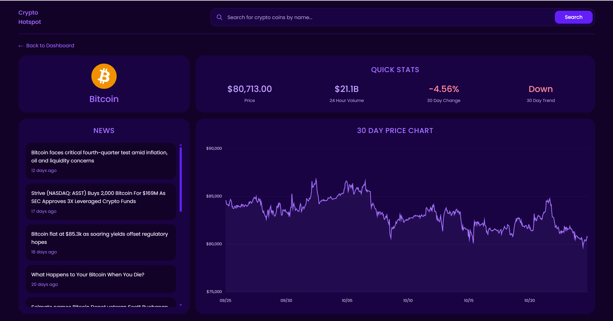

# Crypto Hotspot

A Django cryptocurrency dashboard built for my personal research workflow. It brings market movers, coin statistics, price history, and related news into a single interface.

The project demonstrates third-party API integration, server-side data processing, caching, and a responsive Tailwind CSS interface.




## Features

- **Market movers:** Six gainers and six losers, where available, ranked by 24-hour percentage change within the top 100 coins by market capitalization.
- **Top coins:** Prices and percentage changes for the five largest coins by market capitalization.
- **Coin search:** Search by name or symbol within the cached top-100 market list, or use an exact CoinGecko ID for other coins.
- **Quick statistics:** Current price, trading volume, and 30-day percentage change and direction.
- **Price history:** Interactive 30-day charts powered by Chart.js.
- **Related news:** Articles for the selected coin, with publication age and links to the source.
- **Responsive layout:** Dashboard and coin views adapt to desktop and narrow screens.
- **API failure handling:** Request timeouts, caching, rate-limit cooldowns, and notices when data is stale or unavailable.

## Technology

- Python and Django 5.2
- Tailwind CSS 4
- Chart.js
- Requests
- SQLite for Django's built-in database functionality
- WhiteNoise and Gunicorn for deployment support

Market and news data come from external APIs rather than a local cryptocurrency database.

## Data Sources

- [CoinGecko](https://www.coingecko.com/en/api): Market data, coin details, and price history.
- [Mediastack](https://mediastack.com/): Related news articles.

A Mediastack API key is required for news. A CoinGecko Demo API key can optionally be supplied through the environment.

## Local Setup

The refresh was tested with Python 3.11 and Node.js 20. Node.js and npm are used to compile Tailwind CSS.

The following commands use Windows Command Prompt.

### 1. Clone the repository

```bat
git clone https://github.com/ry-schwartz/crypto_tracker.git
cd crypto_tracker
```

### 2. Create a virtual environment and install dependencies

```bat
python -m venv v_env
v_env\Scripts\activate
python -m pip install -r requirements.txt
```

On macOS or Linux, activate the environment with:

```bash
source v_env/bin/activate
```

### 3. Configure the environment

Create a file named `.env` in the project root, beside `manage.py`:

```dotenv
DJANGO_SECRET_KEY=replace-with-your-generated-secret-key
DJANGO_DEBUG=true
DJANGO_ALLOWED_HOSTS=localhost,127.0.0.1

NEWS_API_KEY=
COINGECKO_API_KEY=
```

Generate a Django secret key with:

```bat
python -c "from django.core.management.utils import get_random_secret_key; print(get_random_secret_key())"
```

Copy the generated value into `DJANGO_SECRET_KEY`.

Add your Mediastack key to `NEWS_API_KEY` to enable news. Leave `COINGECKO_API_KEY` blank to use the public CoinGecko endpoint without a key, or supply a Demo API key.

The `.env` file is ignored by Git. Never commit real credentials.

### 4. Build the styles

```bat
npm ci
npm run build
```

The compiled stylesheet is included in the repository. Rebuild it whenever templates or Tailwind input styles change.

### 5. Initialize Django and start the application

```bat
python manage.py migrate
python manage.py check
python manage.py runserver
```

Open http://127.0.0.1:8000/.

## Development

Run Django in one terminal:

```bat
python manage.py runserver
```

Run the Tailwind watcher in another terminal:

```bat
npm run watch
```

Tailwind reads templates from `tracker/templates` and compiles:

- Input: `tracker/static/css/input.css`
- Output: `tracker/static/css/tailwind.css`

Before committing styling changes, generate the minified stylesheet:

```bat
npm run build
```

Commit both the input and compiled CSS, along with `package.json` and `package-lock.json`.

## Usage

Select a coin from the dashboard or search for a coin such as `Bitcoin`, `BTC`, or `bitcoin`.

Name and symbol matching uses the top-100 market list. For coins outside that list, use the exact CoinGecko ID. Symbols can be shared by multiple coins; ambiguous matches require a more specific search.

The coin page displays quick statistics, a 30-day price chart, and related news. News links open the original article in a new tab.

## API Limits and Data Availability

This project uses free API access for demonstration. It does not stream prices or automatically refresh the page.

Responses are cached to reduce repeated requests. When a provider fails or rate-limits requests, the application can display previously cached data with a notice. Data that has not been cached may remain unavailable until the provider responds again.

The default Django cache is local to each application process. Restarting the server clears that process's cache, and separate workers do not share cached responses.

News availability depends on the selected coin, provider coverage, and API plan. Articles may be older than the displayed market data. The news panel distinguishes an empty result from a fetch error.

A higher-limit API plan can support heavier usage. Paid CoinGecko plans may require changes to the API endpoint and authentication; the current optional key configuration is for the Demo API.

## Validation

To check the Python environment and Django configuration:

```bat
python -m pip check
python manage.py check
```

Manual checks performed during the refresh included:

- Dashboard and coin-page loading.
- Name and symbol searches.
- Chart and news rendering.
- Rate-limit and unavailable-data behavior.
- Responsive layouts at narrow browser widths.

These checks are not a comprehensive automated test suite.

## Deployment

The repository includes a Gunicorn entry point and WhiteNoise middleware. The previous Heroku deployment is obsolete; these setup instructions do not establish a current hosted deployment.

For a new deployment:

- Set `DJANGO_DEBUG=false`.
- Set a private `DJANGO_SECRET_KEY`.
- Set `DJANGO_ALLOWED_HOSTS` to the deployment hostname.
- Configure API credentials through the hosting environment.
- Build Tailwind CSS before collecting static files.
- Run database migrations and collect static files.
- Configure HTTPS and review Django's deployment checks.

```bash
python manage.py migrate
python manage.py collectstatic --noinput
python manage.py check --deploy
```

On a compatible Linux host, the application entry point is:

```bash
gunicorn crypto_tracker.wsgi:application
```

Address deployment-check warnings for the chosen hosting environment before making the application public.